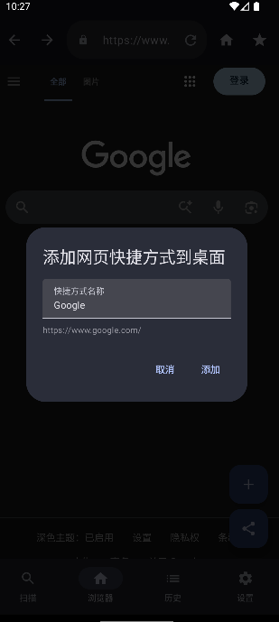
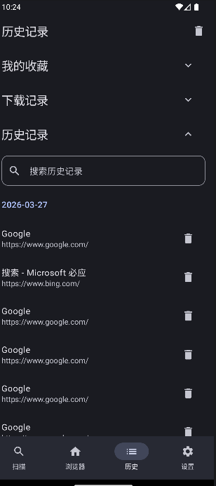
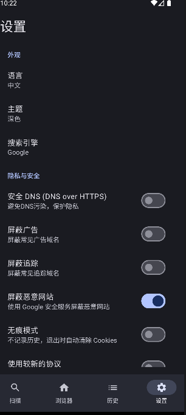

# SyncBrow

[English](#english) | [简体中文](#简体中文)

---

## English

SyncBrow is a privacy-first, security-hardened Android application combining an offline QR code scanner with a lightweight, secure web browser and client-side encrypted password manager. Built using modern Android architecture components, Jetpack Compose, and Material 3, it provides a fast, auditable, and tracking-free browsing experience.

### 📸 Screenshots

  
  
  

### ✨ Key Features

*   **⚡ Local Offline QR Scanner**: Instantly scan and parse QR codes with automatic redirection for valid URLs. Fully offline processing with zero third-party telemetry or network requests.
*   **🛡️ Advanced Privacy & Network Hardening**:
    *   **Secure DNS (DoH)**: Built-in local loopback proxy (`LocalDohProxy`) combined with AndroidX `ProxyController`, routing 100% of WebView traffic through DNS-over-HTTPS (OpenDNS, Cloudflare, Google).
    *   **Encrypted Credential Vault**: Master-password-derived encryption using PBKDF2 (HMAC-SHA256, 100k rounds) and salted AES-256-GCM. Plaintexts are decrypted strictly on-demand in memory.
    *   **Duress & Decoy Mode**: Entering the secondary emergency password activates an isolated Decoy Mode with dynamically synthesized accounts, leaving real credentials secure and untouched.
    *   **Incognito Mode**: Browse without persisting history, cookies, or cache to disk.
    *   **Ad & Tracker Blocker**: Integrated domain filtering for known ad and telemetry domains.
    *   **Safe Browsing**: Proactive defense against malicious sites via Google Safe Browsing integration.
    *   **Sensitive Clipboard Protection**: Automatically marks copied passwords with Android 13+ `EXTRA_IS_SENSITIVE` to suppress floating cleartext previews.
*   **🚀 Enhanced Web Experience**:
    *   **Add-on System**: In-memory cached user scripts (e.g., "Force Copy/Paste" and "Remove Redirect Prompts").
    *   **Download Manager**: Seamless system download integration with asynchronous storage resolution.
    *   **Desktop Shortcuts**: Pin frequently visited web applications directly to the Android home screen.
*   **🎨 Modern UI/UX**:
    *   **Material You**: Dynamic theming and Material 3 design with adaptive dark mode support.
    *   **Customizable Search**: Seamlessly toggle between Google, Bing, and DuckDuckGo/Yahoo.
    *   **Multi-language Support**: Complete localization in English and Simplified Chinese.

### 🛠️ Tech Stack

*   **Language**: Kotlin (JDK 21 LTS toolchain)
*   **UI Framework**: Jetpack Compose & Material 3
*   **Web Engine**: AndroidX WebKit & WebView
*   **Database**: Room (SQLite with schema migrations)
*   **Security & Crypto**: Java Cryptography Architecture (AES-256-GCM, PBKDF2-HMAC-SHA256)
*   **Networking**: OkHttp 4 & OkHttp DnsOverHttps
*   **Optimization**: R8 code shrinking and resource optimization enabled

---

## 简体中文

SyncBrow 是一款注重用户隐私与系统安全的 Android 应用，将纯本地离线二维码扫描器与深度安全加固的网页浏览器、客户端加密密码库融为一体。基于 Jetpack Compose 与 Material 3 构建，提供极速、可审计且零遥测的浏览体验。

### 📸 演示截图

  
  
  

### ✨ 核心功能

*   **⚡ 本地离线扫码**: 快速扫描并解析二维码，支持有效网址自动跳转。全程采用纯本地离线计算，杜绝第三方 SDK 遥测与数据回传。
*   **🛡️ 隐私加固与安全网络**:
    *   **安全加密 DNS (DoH)**: 采用本地环回代理服务（`LocalDohProxy`）与 AndroidX `ProxyController` 深度结合，实现 WebView 全量网络流量（含 POST、子资源请求）强制走 HTTPS DNS 解析（预置 OpenDNS、Cloudflare、Google）。
    *   **主密码加密凭据库**: 采用 PBKDF2 (HMAC-SHA256, 100,000 次哈希迭代) 盐值派生主密钥与 AES-256-GCM 认证加密。明文仅在渲染或复制时按需瞬时解密，内存不持久驻留。
    *   **防胁迫诱饵模式 (Decoy Mode)**: 输入紧急备用密码进入纯内存诱饵模式，动态合成仿真虚假凭据，不删除、不污染底层真实加密数据库。
    *   **无痕浏览模式**: 不持久化任何历史记录、Cookie 或缓存数据。
    *   **广告与追踪拦截**: 内置域名过滤列表，拦截常见广告与隐私分析追踪。
    *   **安全浏览保护**: 集成 Google Safe Browsing 协议，主动拦截已知钓鱼与恶意网址。
    *   **剪贴板隐私防泄露**: 密码复制在 Android 13+ 系统自动标记 `EXTRA_IS_SENSITIVE`，抑制系统浮窗明文显示。
*   **🚀 增强网页体验**:
    *   **用户脚本系统**: 内存驻留缓存的高性能脚本系统（如“解除复制限制”、“移除重定向拦截”）。
    *   **异步下载管理**: 深度整合系统下载服务，存储解析操作完全下放至 IO 协程。
    *   **桌面快捷方式**: 将常用网页一键添加至系统桌面。
*   **🎨 高级 UI/UX**:
    *   **Material You**: 遵循 Material 3 设计语言，支持动态取色与平滑深色模式。
    *   **个性化搜索引擎**: 支持自由切换主流隐私搜索引擎。
    *   **多语言支持**: 完整中英文双语无缝切换。

### 🛠️ 技术栈

*   **编程语言**: Kotlin (JDK 21 LTS 构建链)
*   **UI 框架**: Jetpack Compose & Material 3
*   **网页核心**: AndroidX WebKit & WebView
*   **持久化层**: Room (SQLite)
*   **加密与安全**: JCA (AES-256-GCM, PBKDF2-HMAC-SHA256)
*   **网络通信**: OkHttp 4 & OkHttp DnsOverHttps
*   **混淆优化**: 开启 R8 代码混淆、死代码裁剪与资源压缩

---

## 📄 License

This project is licensed under the Apache License 2.0 - see the [LICENSE](LICENSE) file for details.
